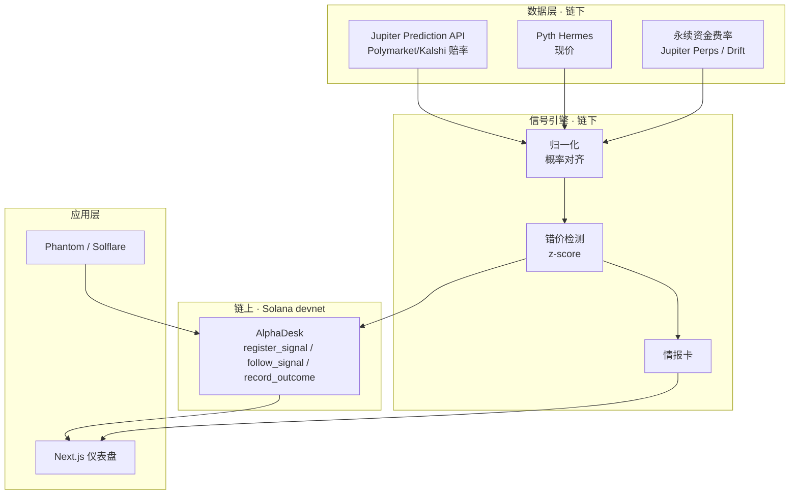

# Prediction Alpha Agent

把预测市场的隐含概率与永续合约的定价信息放在一起比对，自动发现系统性错价，输出可执行、可验证的 AI 信号。

## 演示
- 视频：TODO
- 在线 demo：TODO
- 截图：TODO

## 它做什么
1. 实时拉取预测市场（Polymarket / Kalshi，经 Jupiter Prediction API）与永续定价数据。
2. 用可解释的规则检测「两边定价分歧」，产出信号。
3. AI 生成一张情报卡（事件、依据、建议动作、风险）。
4. 用户一键「跟随」，记录写入 Solana 上的 AlphaDesk 程序，形成可验证的 AI 战绩。

## 架构

链上只做信任：登记信号哈希、记录跟随、结算后写入结果。拉数、算概率、写情报卡都在链下。



当前页面已经打通的是：预置或本地生成的信号与情报卡、钱包签名、`follow_signal`，以及回读链上 `followers`。预测市场下单接口在 ingest 里留了未签名交易的封装，仪表盘还没有接这一步。

## 数据来源

| 来源 | 用途 | 入口 |
| --- | --- | --- |
| Jupiter Prediction API | Polymarket / Kalshi 事件与隐含概率（价格 0.01–0.99） | `https://api.jup.ag/prediction/v1`，请求头 `x-api-key` |
| Pyth Hermes | SOL / BTC 等现价，用来算模型概率 | `PYTH_HERMES_URL`，需要 API Key |
| Jupiter Perps / Drift | 资金费率。官方 Perps API 仍不稳定，ingest 里按可替换来源接 | `PERP_FUNDING_SOURCE` |

没有密钥时，页面不访问这些接口。它读 `fixtures/signals.sample.json` 和 `fixtures/intel_cards.sample.json`。

## 快速开始

前置：Node 20+、pnpm 9。跟 devnet 交互时再装 Solana CLI 与 Anchor 0.30.1。

### 只看 demo（不需要 .env）

```bash
git clone https://github.com/bluescorpio/prediction-alpha-agent.git
cd prediction-alpha-agent
pnpm install
pnpm web
```

打开 http://localhost:3000/ 。仓库里没有 `.data/` 时，页面回退到 `fixtures/*.sample.json`，能看到三条预置信号和对应情报卡。这三笔信号已经在 devnet 上注册过，卡片会显示链上 followers。未连接钱包时「跟随」是灰的。

### 本地重跑数据，再在 devnet 上跟随

```bash
cp .env.example .env
# 填 JUP_API_KEY、PYTH_API_KEY、RPC_URL
# Next 不读仓库根目录的 .env，把下面两行再写进 apps/web/.env.local
# NEXT_PUBLIC_RPC_URL=https://api.devnet.solana.com
# NEXT_PUBLIC_PROGRAM_ID=5L7SHJT5uK59tFyYNzuA7qrGorxyEwcXur4Gi28HhyYh

pnpm ingest    # 拉取事件、价格、资金费率，写入 .data/
pnpm signals   # 产出信号
pnpm narrate   # 生成情报卡；没配 LLM 时用模板文案
pnpm seed      # 把 .data/signals.json 登记到 devnet，并写回 onchain.signalPda
pnpm web
```

`pnpm seed` 用 `ANCHOR_WALLET`，缺省是 `~/.config/solana/id.json`，RPC 用 `.env` 里的 `RPC_URL`。页面上连接 Phantom 或 Solflare（切到 devnet），对某条信号点「跟随」。确认后按钮变为「已跟随」，链上 followers 加 1，交易签名出现在卡片上。

## 信号逻辑

当前引擎只产出类型 A。B 和 C 已写进共享类型，检测还没接上。

- A 跨市场定价分歧（已实现）：用现价、年化波动率（默认 0.6）和到期天数（默认 30）估算「价格站上阈值」的模型概率，再和预测市场隐含概率做 z-score。`z = (p_market - p_model) / σ_hist`，`σ_hist` 默认 0.08。`|z| ≥ 2` 才出信号；z 为正是预测市场偏贵（`pm_overpriced`），为负是偏便宜。
- B 拥挤度预警：资金费率处在极值，同时预测市场情绪一边倒。
- C 事件驱动未反应窗口：预测市场概率已经跳了，永续的波动或资金费率还没动。

情报卡按 `marketId` + `provider` 和信号对齐，展示 `suggestedAction` 与 `riskNotes`。缺 LLM 配置时，文案是模板，不是模型解读。

## 链上

AlphaDesk Program ID：`5L7SHJT5uK59tFyYNzuA7qrGorxyEwcXur4Gi28HhyYh`（devnet 已部署）

| 指令 | 作用 |
| --- | --- |
| `register_signal` | 按 `["signal", authority, signalHash]` 建信号账户，只存哈希、类型、方向、置信度 |
| `follow_signal` | 按 `["follow", signal, user]` 建跟随账户，并把该信号的 followers 加 1 |
| `record_outcome` | 结算后由登记者写入结果 |

预置三条信号的 PDA 写在 `fixtures/signals.sample.json` 的 `onchain.signalPda` 里，可以用 `solana account <PDA> --url devnet` 核对。

## 路线图 / 赛后计划

黑客松交的是「分歧能被看见，跟随能被验证」。赛后继续用同一条链路做内容，而不是把仓库停在演示。

1. 情报卡按固定节奏从真实事件里出，直接当选题。每张卡都能指回链上账户，读者可以自己核对 followers 和之后写入的 outcome。
2. 补上类型 B、C，以及一段能复看的历史，而不是只留当前这一屏。
3. 把 ingest 里已经封装的预测市场未签名订单接到「跟随」之后，让执行和记账分开、都留得下凭证。
4. 结算脚本调用 `record_outcome`，把战绩从「有多少人跟随」变成「这条判断后来对不对」。
